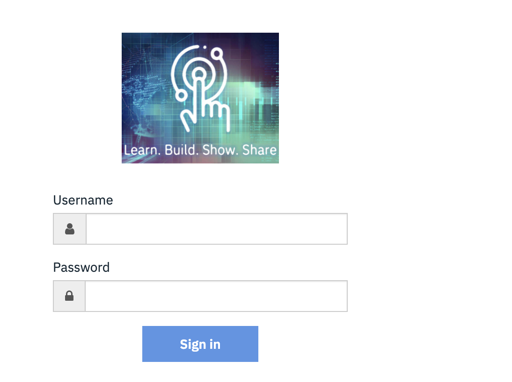
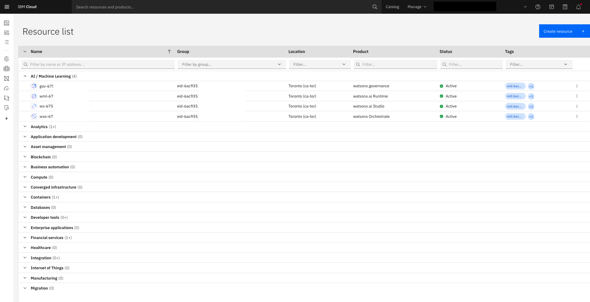
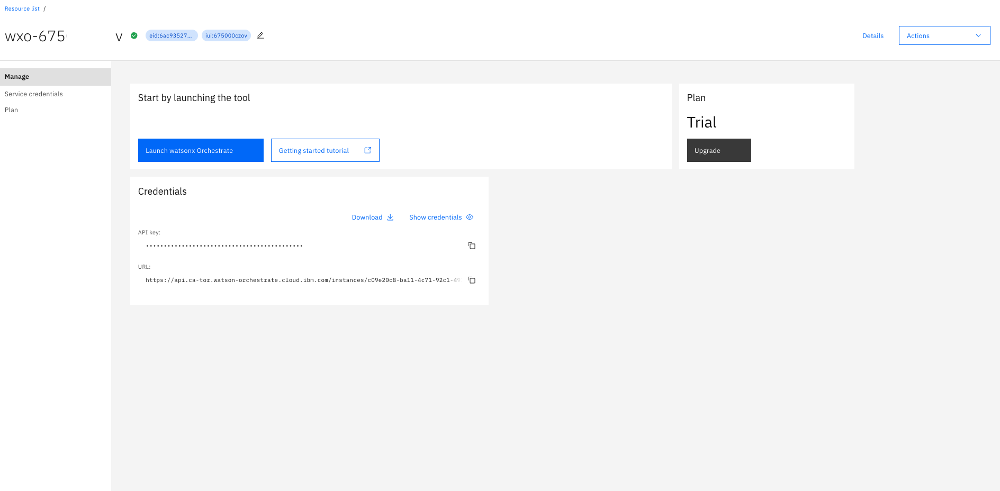
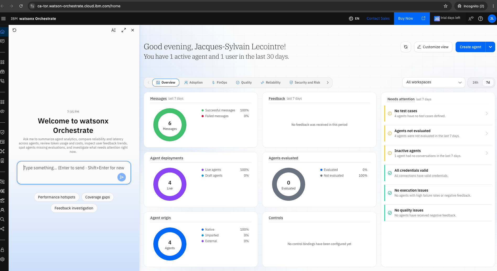

# Bien démarrer

Tous les tutoriels utilisent une instance **watsonx Orchestrate**. Cette page explique comment y accéder (essai gratuit avec votre IBMid ou identifiants fournis pour l'atelier), comment l'ouvrir et où trouver les identifiants d'API qui servent à l'ADK (partie 5).

## Option 1 : Se connecter avec votre IBMid

1. Ouvrez le formulaire d'[essai gratuit de 30 jours](https://www.ibm.com/account/reg/us-en/signup?formid=urx-54418){target="_blank" rel="noopener"}.
1. Connectez-vous avec votre IBMid, ou [créez-en un](https://www.ibm.com/account/reg/us-en/signup?formid=urx-19776){target="_blank" rel="noopener"}.
1. Choisissez la plateforme (**IBM Cloud** ou **AWS**) et la région, puis validez.

L'essai dure **30 jours** (le nombre de jours restants s'affiche dans la barre du haut de l'interface). Le provisionnement prend quelques minutes.

/// note
Sur IBM Cloud, l'essai crée aussi des services watsonx.ai et watsonx.governance, utilisés en arrière-plan par watsonx Orchestrate.
///

## Option 2 : Se connecter avec des identifiants fournis

1. Ouvrez l'URL qui vous a été fournie.
1. Saisissez l'identifiant (**Username**) et le mot de passe (**Password**) fournis, puis cliquez sur **Sign in**.

Vous avez ainsi accès à un environnement IBM Cloud avec watsonx Orchestrate pendant toute la durée de l'atelier.



## Retrouver l'instance dans IBM Cloud

1. Ouvrez la [liste des ressources IBM Cloud](https://cloud.ibm.com/resources).
1. Dépliez **AI / Machine Learning** et cliquez sur la ressource dont le produit est **watsonx Orchestrate** (nommée `wxo-…`). Son statut doit être **Active**.



## Lancer watsonx Orchestrate

La page de l'instance indique le plan (**Trial**) et propose deux actions :

- **Launch watsonx Orchestrate** : ouvre l'interface de watsonx Orchestrate ;
- **Credentials** : la clé d'API et l'URL de l'instance (voir [plus bas](#obtenir-lurl-de-linstance-et-la-cle-dapi)).

Cliquez sur **Launch watsonx Orchestrate**.



/// tip
Ajoutez l'URL de l'interface (`https://<région>.watson-orchestrate.cloud.ibm.com/home`) à vos favoris pour y revenir directement.
///

## Découvrir l'interface

La page d'accueil de watsonx Orchestrate comprend :

- **à gauche**, le menu de navigation (chat, Agent Builder, outils, connexions, paramètres…) et un panneau de chat avec l'assistant intégré ;
- **au centre**, un tableau de bord sur vos agents : messages, déploiements, évaluations, origine des agents, avec des onglets **Adoption**, **FinOps**, **Quality**, **Reliability** et **Security and Risk** ;
- **à droite**, les points d'attention (agents sans cas de test, agents inactifs, identifiants invalides…) ;
- **en haut à droite**, le bouton **Create agent**, point de départ des parties 3 et 4.



## Obtenir l'URL de l'instance et la clé d'API

Ces identifiants ne sont nécessaires que pour l'ADK et la ligne de commande `orchestrate` (partie 5). Les parties 1 à 4 se font entièrement dans le navigateur.

1. Sur la page de l'instance dans IBM Cloud (capture ci-dessus), section **Credentials**, cliquez sur **Show credentials** (ou **Download**).
1. Copiez l'**API key** et l'**URL** (`https://api.<région>.watson-orchestrate.cloud.ibm.com/instances/<id>`).
1. Renseignez-les dans le fichier `.env` à la racine du projet :

    ```shell title=".env"
    WXO_ENV_NAME=wxo-trial
    WXO_URL=https://api.<région>.watson-orchestrate.cloud.ibm.com/instances/<id>
    WXO_API_KEY=<votre clé d'API>
    ```

1. Ajoutez et activez l'environnement :

    ```shell
    make bob-orchestrate-activate
    ```

    Ce qui équivaut à :

    ```shell
    orchestrate env add -n wxo-trial -u "$WXO_URL" --type ibm_iam
    orchestrate env activate wxo-trial --api-key "$WXO_API_KEY"
    ```

/// warning | Clé d'API
La clé d'API donne accès à votre instance : ne la partagez pas et ne la versionnez pas (`.env` est ignoré par Git).
///
