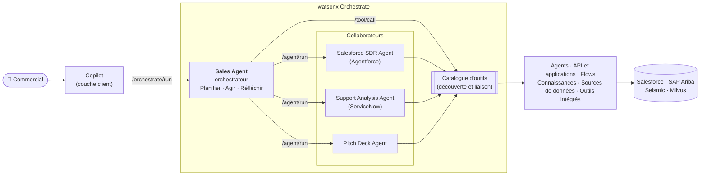

# 1. Introduction à watsonx Orchestrate

Cette partie présente l'orchestration d'agents IA et la façon dont watsonx Orchestrate la met en œuvre.

Source : [Introduction to watsonx Orchestrate](https://developer.ibm.com/learningpaths/get-started-watsonx-orchestrate/introduction/) (IBM Developer).

## Qu'est-ce que l'orchestration d'agents ?

L'orchestration d'agents IA consiste à coordonner plusieurs agents autonomes pour qu'ils fonctionnent comme un seul système, à la manière d'un chef d'orchestre.

Exemple : pour l'intégration d'un nouvel employé, un agent collecte les informations du candidat, un deuxième lance la vérification des antécédents et un troisième crée les accès informatiques. L'orchestration déclenche chaque agent au bon moment, fait circuler les données entre eux et gère les erreurs.

Contrairement à une automatisation simple, où les tâches s'exécutent de façon isolée, l'orchestration :

- **partage le contexte** et **conserve l'état** d'une étape à l'autre ;
- **gère les dépendances** et l'ordre d'exécution des tâches ;
- **s'adapte** grâce à la logique conditionnelle, aux nouvelles tentatives en cas d'échec et aux chemins de repli.

Chaque agent devient ainsi une brique réutilisable, spécialisée dans une tâche : les workflows sont modulaires et évoluent avec les besoins métier.

## Fonctionnalités clés

watsonx Orchestrate permet de développer, composer et exécuter plusieurs agents dans un workflow coordonné, sans moteur de workflow externe ni code d'intégration. Les agents y sont des services modulaires et réutilisables : ils raisonnent, s'intègrent aux systèmes de l'entreprise ou délèguent à d'autres agents.

| Fonctionnalité | Ce qu'elle apporte |
| :--- | :--- |
| **Appels d'agents imbriqués** | Un agent en appelle d'autres pour déléguer des sous-tâches, ce qui forme une hiérarchie. Exemple : un agent *Procure Equipment* délègue à *Request Quotes*, *Evaluate Vendors* et *Submit Purchase Request*, sans code de liaison. |
| **Séquencement et contrôle du flux** | Exécution d'étapes dans l'ordre, conditions et nouvelles tentatives. La sortie d'un agent peut devenir l'entrée du suivant, ou le chemin s'adapter à ses résultats. |
| **Propagation du contexte** | Tous les agents partagent un contexte commun (saisie de l'utilisateur, résultats des agents, données utiles) qui circule d'une étape à l'autre, sans stockage spécifique ni suivi manuel. |
| **Catalogue d'agents réutilisables** | Des agents prédéfinis par domaine (RH, achats…) à utiliser tels quels ou comme modèles. Vous pouvez aussi publier vos propres agents, créés avec l'**Agent Builder** (sans code) ou l'**ADK** (pro-code). |

## Exemple : un scénario commercial

Un commercial prépare un rendez-vous client depuis Copilot, son assistant conversationnel :

> *« J'ai rendez-vous vendredi avec le CRO d'Adobe. Montre-moi la dernière offre que je peux lui présenter. »*

Copilot transmet la demande à l'**agent orchestrateur** (ici le *Sales Agent*) dans watsonx Orchestrate, qui suit un cycle **Planifier, Agir, Réfléchir** :

1. **Planifier** : il découpe la demande en tâches :
    1. analyser les droits actuels d'Adobe (SAP Ariba) ;
    2. vérifier l'état des tickets de support (ServiceNow) ;
    3. identifier les nouvelles offres (recherche web, Seismic) ;
    4. créer une présentation sur mesure ;
    5. envoyer un e-mail au CRO avec la présentation en pièce jointe.
2. **Agir** : il délègue ces tâches à des **agents collaborateurs**, exposés comme des outils. Chaque collaborateur utilise à son tour des **outils** (API, workflows, sources de données) pour accéder aux systèmes de l'entreprise.

/// tip | Une plateforme ouverte
watsonx Orchestrate est agnostique : ses agents peuvent être utilisés depuis des applications externes (comme Copilot ici), et des agents ou outils d'autres plateformes peuvent participer à un workflow orchestré.
///
