# 3. Développer des agents sans code

Source : [Develop agents with no code using watsonx Orchestrate](https://developer.ibm.com/learningpaths/get-started-watsonx-orchestrate/develop-agents-no-code/).

## Cas d'usage

Vous allez créer, dans le navigateur et sans code, un système multi-agents d'analyse de résultats financiers :

- **Earning Report Analyst** (superviseur) : point d'entrée unique. Il identifie la ou les entreprises concernées, transmet les questions aux bons agents spécialistes et consolide leurs réponses en une réponse unique, avec citations.
- **PepsiCo Earning Report Analyst** et **Coca-Cola Earning Report Analyst** (spécialistes) : chacun analyse les communiqués de résultats et les transcriptions de son entreprise, stockés dans sa propre base de connaissances (via RAG).

Le superviseur est ensuite exposé sur **WhatsApp** (via Twilio), en plus du chat web de watsonx Orchestrate. La même approche s'applique aux autres canaux.

/// note
Les noms PepsiCo et Coca-Cola ne servent qu'à illustrer le tutoriel, sans aucune affiliation.
///

## Architecture

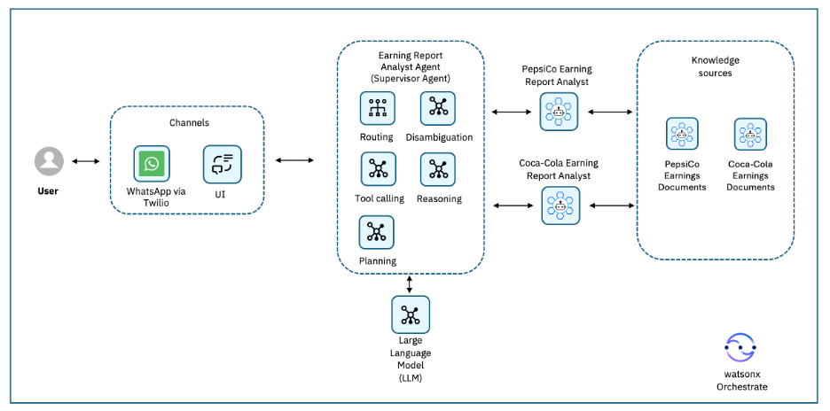

| Composant | Rôle |
| :--- | :--- |
| **Canaux** | WhatsApp (Twilio) et chat web watsonx Orchestrate |
| **Superviseur** | Routage, clarification des demandes vagues (entreprise, période, indicateur), appel d'outils, planification et consolidation |
| **Spécialistes** | Analyse des documents d'une entreprise |
| **Connaissances** | Documents financiers publics, indexés pour la recherche (RAG) : réponses précises et sourcées |
| **LLM** | [gpt-oss-120b](https://www.ibm.com/docs/en/watsonx/saas?topic=models-third-party-foundation#gpt-oss) : compréhension, planification et rédaction des réponses |

## Exemple de flux

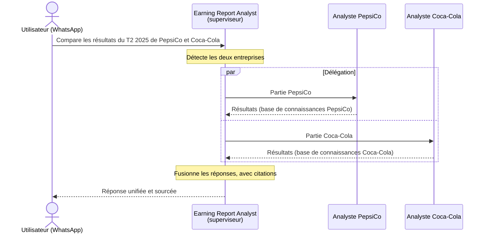

## Prérequis

- Une instance watsonx Orchestrate.
- Les documents financiers, téléchargés dans [`data/earnings/`](https://github.com/jslecointre/wxo_tuto/tree/main/data/earnings) avec :

    ```shell
    make earnings-docs
    ```

- Pour l'étape 5 (optionnelle) : un compte [Twilio](https://www.twilio.com/).

/// tip | Contenu à copier
Les blocs de texte ci-dessous sont à coller tels quels dans watsonx Orchestrate (bouton de copie en haut à droite de chaque bloc). Ils restent en anglais, comme les documents.
///

/// note | Instance partagée
En atelier, plusieurs participants utilisent la même instance : ajoutez vos initiales à la fin du nom de chaque agent (par exemple `PepsiCo Earning Report Analyst - AA`).
///

## Étape 1. Créer l'agent PepsiCo Earning Report Analyst

1. Ouvrez watsonx Orchestrate dans votre navigateur et allez dans la section **Active inventory** > **Agents**.

    

1. Cliquez sur **Create agent** (bouton bleu en haut à droite), puis **Create from scratch**.
1. Saisissez le nom et la description, puis cliquez sur **Create**. La description n'est pas optionnelle : elle définit le périmètre de l'agent et permet aux autres agents de savoir quand l'appeler.

    ```text title="Name"
    PepsiCo Earning Report Analyst
    ```

    ```text title="Description"
    Answers PepsiCo earnings questions by analyzing PepsiCo earnings releases, press releases and management remarks across the years.
    ```

1. **Model** : choisissez [gpt-oss-120b](https://www.ibm.com/docs/en/watsonx/saas?topic=models-third-party-foundation#gpt-oss) (*GPT-OSS 120B — OpenAI (via Groq)*).

    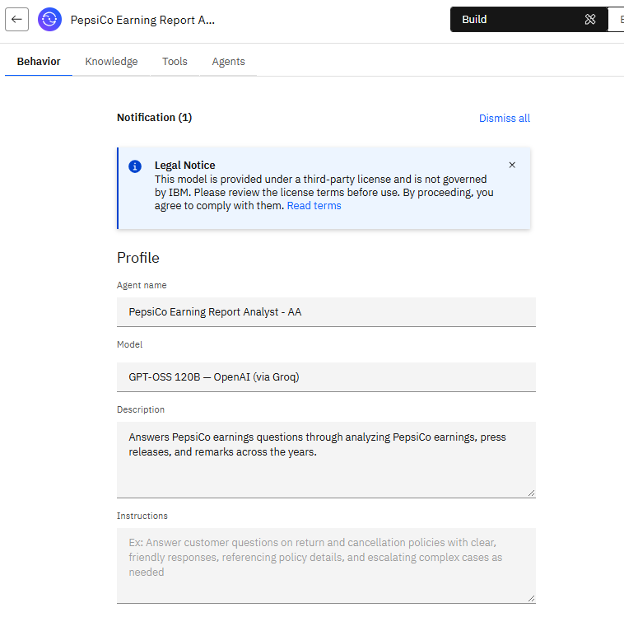

1. **Knowledge** : cliquez sur **Add Source > New knowledge**, sélectionnez **Upload files**, puis **Next**. Les autres sources possibles sont Milvus (watsonx.data), Elasticsearch ou un service personnalisé.
1. Glissez les 4 fichiers de `data/earnings/pepsico/`, puis cliquez sur **Next**.

    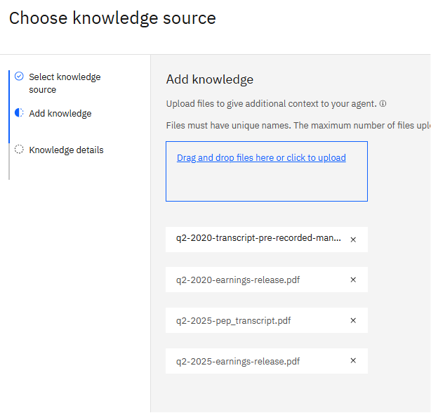

1. Nommez la source `PepsiCo earning reports`, saisissez la description ci-dessous (elle indique à l'agent quand utiliser ces documents), puis cliquez sur **Save**. Les documents sont téléversés et indexés.

    ```text title="Knowledge description"
    These documents contain PepsiCo's quarterly earnings press releases and prepared management remarks for Q2 2025 and Q2 2020. They provide official financial results (net revenue, organic revenue growth, EPS, margins) and management commentary on performance drivers, to support comparisons across periods.
    ```

    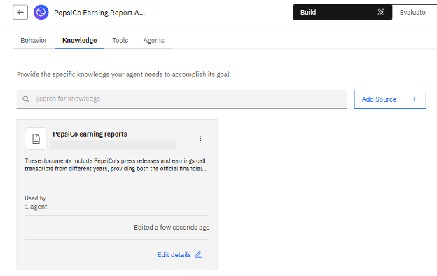

1. **Behavior** : collez les instructions (ce que l'agent doit faire, comment répondre et ses restrictions) :

    ```text title="Instructions"
    You are a financial analyst specialized in PepsiCo earnings.
    - Answer only from the PepsiCo documents in your knowledge base, and use all relevant documents.
    - When comparing periods, retrieve the figures for each period before comparing them.
    - Combine figures from the press releases with management commentary from the remarks.
    - Cite the source document and its date for every figure.
    - Explain trends using both historical and current data.
    - Do not speculate or make forecasts that the documents do not support.
    ```

    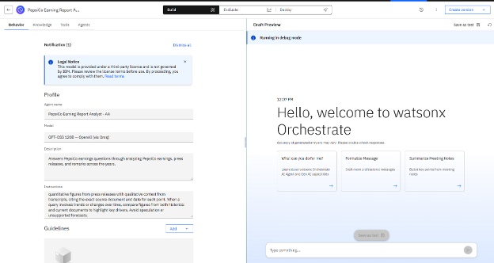

1. Testez l'agent avant de le déployer : posez la question suivante dans le panneau **Draft Preview** à droite.

    ```text title="Prompt de test"
    Compare PepsiCo's net revenue in Q2 2025 with Q2 2020, and summarize one key performance driver mentioned by management for each year.
    ```

    Cliquez sur l'icône **^** pour afficher les citations : la réponse s'appuie sur plusieurs documents, ce qui limite le risque d'hallucination.

    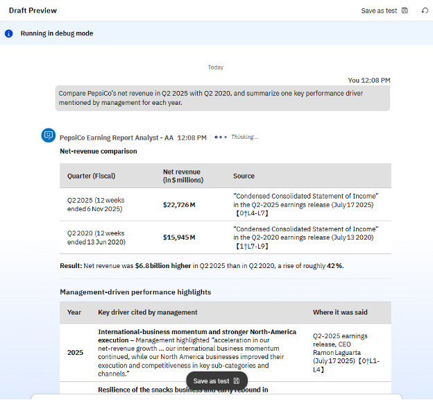

1. Cliquez sur **Deploy**. Dans **Channels > Orchestrate chat**, désactivez l'affichage de l'agent (**Show Agent**) : il n'est appelé que par le superviseur.
1. Cliquez sur **Deploy to Live**, puis **Create new version** : reprenez le même nom, version `1.0.0`, puis **Deploy**.

    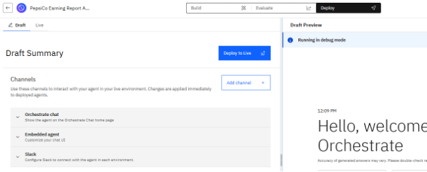

## Étape 2. Créer l'agent Coca-Cola Earning Report Analyst

Dans **Active inventory** > **Agents**, cliquez sur **Create agent > Create from scratch**, et procédez comme à l'étape 1 avec :

```text title="Name"
Coca-Cola Earning Report Analyst
```

```text title="Description"
Answers Coca-Cola earnings questions by analyzing Coca-Cola earnings releases and earnings call transcripts across the years.
```

- **Knowledge** : **Add Source > New knowledge > Upload files**, les 4 fichiers de `data/earnings/coca-cola/`, nom de la source `Coca Cola earning reports`.

    ```text title="Knowledge description"
    These documents contain Coca-Cola's quarterly earnings releases and earnings call transcripts for Q2 2025 and Q2 2020. They provide official financial results (net revenues, organic revenue growth, unit case volume, EPS, margins) and management explanations and outlook, to support comparisons across periods.
    ```

- **Behavior** :

    ```text title="Instructions"
    You are a financial analyst specialized in Coca-Cola earnings.
    - Use the earnings releases as the primary source for financial figures.
    - Use the earnings call transcripts for management explanations, context and forward-looking statements.
    - When comparing periods, align metric definitions and highlight the changes.
    - Cite the source document and its date for every figure.
    - Do not speculate beyond what the documents support.
    ```

- **Test** dans **Draft Preview** :

    ```text title="Prompt de test"
    Compare Coca-Cola's primary growth driver in Q2 2025 with its primary growth driver in Q2 2020, and explain how each was influenced by market conditions at the time.
    ```

    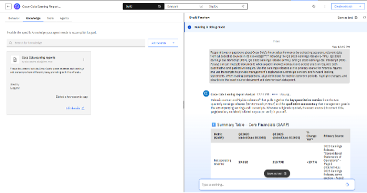

- **Deploy** : désactivez **Show Agent**, puis **Deploy to Live > Create new version** (version `1.0.0`) **> Deploy**.

## Étape 3. Créer l'agent superviseur

Le superviseur délègue les questions aux deux agents spécialistes.

1. Dans **Active inventory** > **Agents** (la liste des agents créés s'affiche), cliquez sur **Create agent > Create from scratch** avec :

    ```text title="Name"
    Earning Report Analyst
    ```

    ```text title="Description"
    Routes earnings questions about PepsiCo and Coca-Cola to the right specialist agent, coordinates questions that span several companies or periods, and consolidates the answers into a single cited response.
    ```

1. **Toolset > Agents > Add agent > Add from local instance** : cochez *PepsiCo Earning Report Analyst* et *Coca-Cola Earning Report Analyst* (ceux à vos initiales), puis cliquez sur **Add to agent**.

    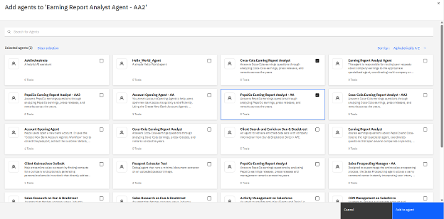

1. **Behavior** :

    ```text title="Instructions"
    - Delegate all PepsiCo earnings questions to the PepsiCo Earning Report Analyst agent.
    - Delegate all Coca-Cola earnings questions to the Coca-Cola Earning Report Analyst agent.
    - For questions about both companies, send each part to the matching agent, then merge the answers into one well-structured response that keeps the citations of each agent.
    - If the company, period or metric is unclear, ask the user to clarify before delegating.
    ```

1. Laissez **Show Agent** activé : c'est le seul agent visible des utilisateurs.
1. Avant de déployer, testez le comportement des 3 agents : dans le panneau de droite, posez les questions suivantes.

    Question pour l'agent Coca-Cola :

    ```text title="Prompt de test"
    Compare Coca-Cola's primary growth driver in Q2 2025 with its primary growth driver in Q2 2020, and explain how each was influenced by market conditions at the time.
    ```

    Question pour l'agent PepsiCo :

    ```text title="Prompt de test"
    Compare PepsiCo's net revenue in Q2 2025 with Q2 2020, and summarize one key performance driver mentioned by management for each year.
    ```

    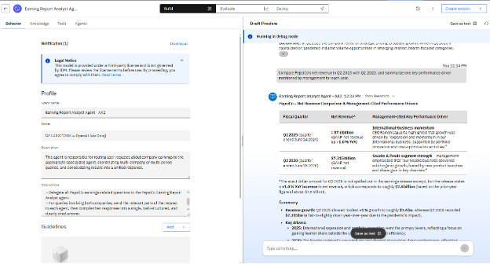

    Le superviseur doit transmettre chaque question au bon spécialiste : cliquez sur **Show Reasoning** pour voir l'appel à l'outil `chat_with_collaborator_…` de l'agent concerné, et vérifiez les citations dans les réponses.

    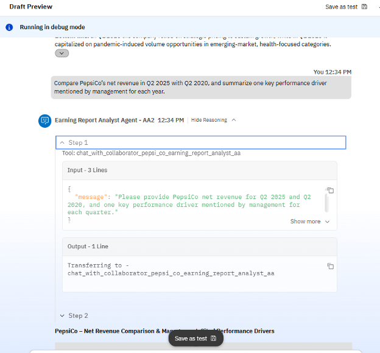

1. Cliquez sur **Deploy > Deploy to Live > Create new version** (version `1.0.0`) **> Deploy**.

## Étape 4. Tester les agents

1. Ouvrez **Chat** depuis le menu.
1. Dans la liste déroulante **Agents**, sélectionnez *Earning Report Analyst*. Les deux spécialistes n'apparaissent pas : ce sont des agents de support (**Show Agent** désactivé).
1. Posez une question qui concerne les deux entreprises :

    ```text title="Prompt de test"
    In one table, list the Q2 2025 organic revenue growth and main performance driver for PepsiCo and Coca-Cola, using both companies' earnings releases and transcripts
    ```

1. Cliquez sur **Show Reasoning** pour suivre l'orchestration.

    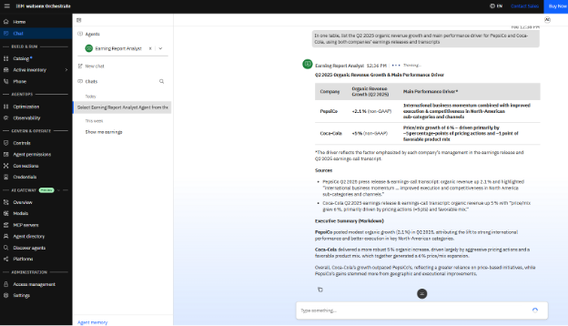

**Résultat attendu** : un seul tableau, une ligne par entreprise (croissance organique du chiffre d'affaires au T2 2025 et principal facteur de performance), avec les sources citées. Le raisonnement montre que le superviseur a interrogé les deux spécialistes, puis fusionné leurs réponses : le LLM du superviseur met les deux réponses au format tableau.

## Étape 5. Exposer le superviseur sur WhatsApp (optionnel)

### 5.1 Récupérer les identifiants Twilio

Dans la [console Twilio](https://console.twilio.com/), section **Account Info**, copiez l'**Account SID** et l'**Auth Token**, puis ajoutez-les au fichier `.env` à la racine du dépôt (ignoré par git) :

```shell title=".env"
TWILIO_ACCOUNT_SID=ACxxxxxxxxxxxxxxxxxxxxxxxxxxxxxxxx
TWILIO_AUTH_TOKEN=xxxxxxxxxxxxxxxxxxxxxxxxxxxxxxxx
```

### 5.2 Configurer la connexion Twilio

1. Dans watsonx Orchestrate, ouvrez **Connections** (menu **Govern & Operate**), onglet **Pre-built**, et recherchez `twilio`.
1. Cliquez sur l'icône de modification de la connexion **Twilio** (`twilio_ibm_184bdbd3`). Son statut est *Configuration pending* tant qu'elle n'est pas configurée.

    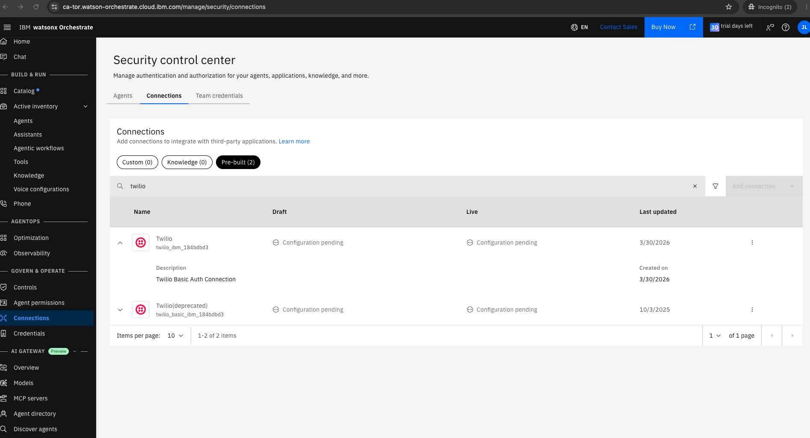

1. Pour **Draft** puis pour **Live**, en authentification **Basic Auth** :

    | Champ | Valeur |
    | :--- | :--- |
    | **Server URL** | `https://api.twilio.com` |
    | **Username** | `TWILIO_ACCOUNT_SID` |
    | **Password** | `TWILIO_AUTH_TOKEN` |

1. Enregistrez puis testez la connexion. Voir la [documentation IBM](https://www.ibm.com/docs/en/watsonx/watson-orchestrate/base?topic=agents-twilio).

### 5.3 Créer le canal WhatsApp

/// tab | Interface

1. Ouvrez *Earning Report Analyst* > **Channels** > **WhatsApp with Twilio**, choisissez **Live**, puis **Create New**.
1. Renseignez le formulaire :

    | Champ | Valeur |
    | :--- | :--- |
    | **Name** | `WhatsApp Twilio Integration` |
    | **Description** | `WhatsApp Twilio Integration` |
    | **Account SID** | `TWILIO_ACCOUNT_SID` |
    | **Auth Token** | `TWILIO_AUTH_TOKEN` |

1. Copiez le **Webhook URL** affiché, puis cliquez sur **Finish**. Le statut doit passer à **Active**.

///

/// tab | make

```shell
make wxo-channel-whatsapp
```

La commande lit `TWILIO_ACCOUNT_SID` et `TWILIO_AUTH_TOKEN` dans `.env`, déploie *Earning Report Analyst* (un canal **Live** nécessite un agent déployé), crée le canal *WhatsApp Twilio Integration* puis affiche son **Event URL** : c'est le webhook. Commandes `orchestrate` détaillées : [5.2, étape 6](../part-05-adk/earning-report-analyst.md#etape-6-exposer-le-superviseur-sur-whatsapp).

///

### 5.4 Configurer le webhook dans Twilio

Dans Twilio, **Messaging > Try it out > Send a WhatsApp message > Sandbox settings** : collez le webhook dans **When a message comes in** (méthode **POST**), puis **Save**.

## Étape 6. Tester depuis WhatsApp

1. Rejoignez le sandbox Twilio : envoyez au numéro du sandbox le message `join <code>` indiqué dans **Sandbox settings**.
1. Envoyez :

    ```text
    hello
    ```

    ```text
    Compare PepsiCo's net revenue in Q2 2025 with Q2 2020.
    ```

    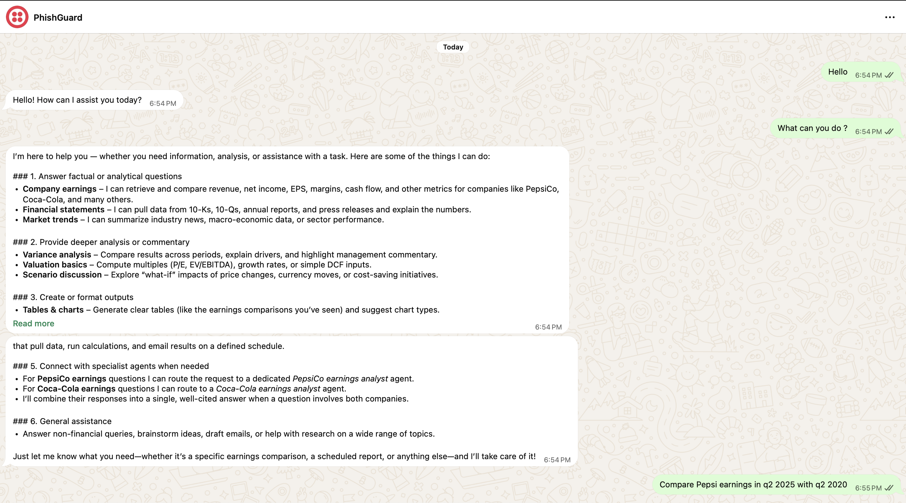

/// warning | Seul l'écho de Twilio répond ?
Vérifiez que le canal est **Active**, que le webhook est identique dans Twilio et que l'agent est bien associé au canal WhatsApp.
///

## Résumé et prochaines étapes

Vous avez créé sans code deux agents spécialistes dotés de leurs propres sources de connaissances, un superviseur qui coordonne leur travail, puis exposé ce dernier sur WhatsApp.

/// tip | Version ADK
Le même système existe en YAML dans `wxo/earnings_report_analyst/` (2 bases de connaissances, 3 agents). Après `make earnings-docs`, importez-le avec `make wxo-import-earnings`. Voir [5.2 Importer le système Earning Report Analyst](../part-05-adk/earning-report-analyst.md).
///

Pour aller plus loin : ajoutez des agents (autres entreprises ou fonctions métier), d'autres canaux (Slack, Microsoft Teams, applications web), d'autres documents, ou des outils pour déclencher des actions (rapports, workflows).
