# 4. Créez des workflows agentiques sans code

Source : [Creating intelligent, reusable agentic workflows on watsonx Orchestrate with no code](https://developer.ibm.com/learningpaths/get-started-watsonx-orchestrate/create-agentic-workflows-no-code/)

Documentation du produit : [Agentic workflows](https://www.ibm.com/docs/en/watsonx/watson-orchestrate/base?topic=tools-agentic-workflows)

## Cas d'usage

Vous créez l'**Account Opening Agent**, un agent qui guide l'utilisateur dans l'ouverture d'un compte bancaire. Son cœur est un outil de type **workflow agentique**, **Create New Bank Account**, construit entièrement sans code dans watsonx Orchestrate. Ce workflow :

1. demande une photo du passeport ;
2. en extrait les informations (nom, numéro de passeport, nationalité…) ;
3. applique une règle déterministe sur la nationalité ;
4. fait intervenir l'humain (*human in the loop*) via un formulaire ;
5. génère un message de confirmation avec un LLM.

Une fois le workflow terminé, vous le rattachez à l'agent.

## Architecture

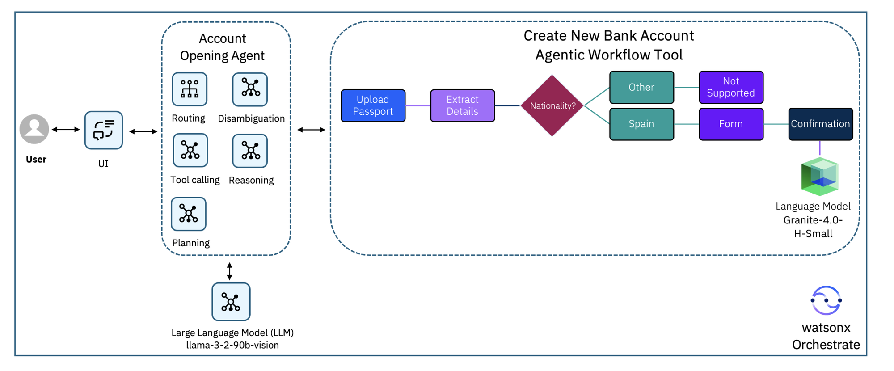

1. L'utilisateur demande, depuis l'interface de chat, à ouvrir un compte.
2. L'**Account Opening Agent** s'appuie sur un LLM (par exemple GPT-OSS 120B) pour interpréter la demande, raisonner, planifier et décider d'appeler un outil.
3. Pour une demande d'ouverture de compte, il appelle l'outil **Create New Bank Account**, qui :
    - demande l'image du passeport ;
    - extrait le nom, le numéro de passeport et la nationalité ;
    - si la nationalité n'est **pas** espagnole, arrête le flux et invite l'utilisateur à se rendre en agence ;
    - si elle est **espagnole**, envoie un formulaire pour compléter les informations (téléphone, type de compte…) ;
    - génère un message de confirmation avec le modèle **Granite 4.0 H Small**.

/// tip | Pour aller plus loin
Le workflow pourrait ensuite appeler le *core banking* pour créer réellement la demande d'ouverture de compte.
///

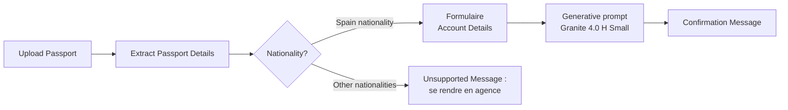

## Étapes

1. Créer l'agent.
2. Créer l'outil de workflow agentique.
3. Extraire les données d'un document.
4. Ajouter la logique conditionnelle.
5. Créer un formulaire (*human in the loop*).
6. Créer le prompt génératif.
7. Déployer l'agent.
8. Tester l'agent.

## Prérequis

- Une instance watsonx Orchestrate.
- Quatre images de passeports **synthétiques**, issues du jeu de données SynID ([arXiv 2505.07540](https://arxiv.org/abs/2505.07540v1)), téléchargées dans [`data/passports/`](https://github.com/jslecointre/wxo_tuto/tree/main/data/passports) avec :

    ```shell
    make passport-images
    ```

    - `passport-1.jpg` et `passport-2.png` servent à entraîner l'extracteur (étape 3) ;
    - `passport-3.png` (non espagnol) et `passport-4.png` (espagnol) servent aux tests (étape 8).

/// tip | Contenu à copier
Les blocs de texte ci-dessous sont à coller tels quels dans watsonx Orchestrate (bouton de copie en haut à droite de chaque bloc). Ils restent en anglais, comme l'interface.
///

/// note | Atelier partagé
Si plusieurs participants travaillent sur la même instance, suffixez le nom de l'agent avec vos initiales (par exemple `Account Opening Agent - AA`) pour le retrouver facilement.
///

## Étape 1. Créer l'agent

Vous créez l'agent qui guide l'utilisateur dans l'ouverture du compte et qui délègue tout le traitement à l'outil **Create New Bank Account Agentic Workflow**.

1. Ouvrez watsonx Orchestrate dans votre navigateur et allez dans la section **Active inventory** > **Agents**.

    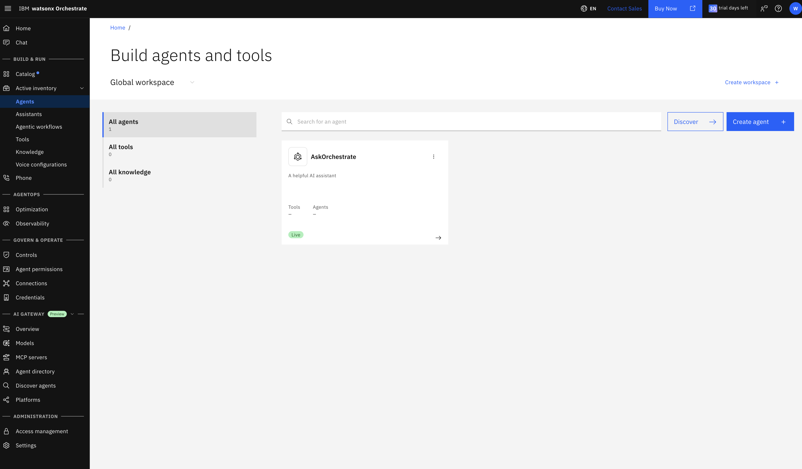

2. Cliquez sur **Create agent** (bouton bleu en haut à droite) pour ouvrir l'Agent Builder, puis choisissez **Create from scratch**.

    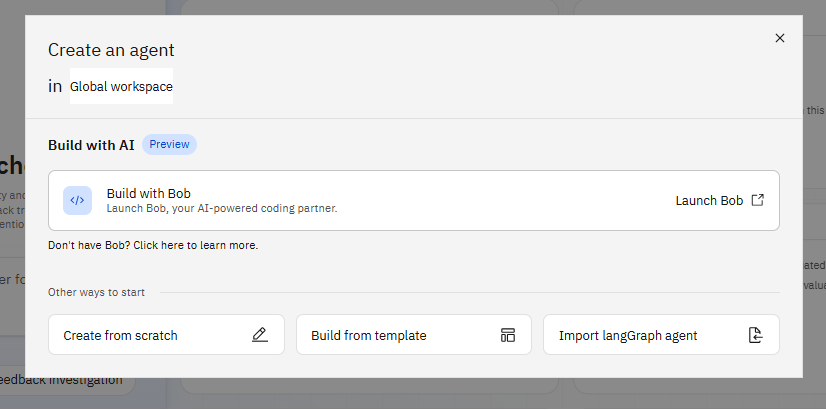

1. Saisissez le nom et la description, puis cliquez sur **Create**.

    ```text title="Name"
    Account Opening Agent - [vos initiales]
    ```

    ```text title="Description"
    You are an Account Opening Agent to help users open new bank accounts quickly and efficiently. Using the Create New Bank Account Agentic Workflow tool, you guide users through each step of the account opening process, starting with passport upload and automated detail extraction, followed by nationality checks using deterministic logic. You handle human-in-the-loop activities like form submissions and confirmation messages, and generate personalized responses using AI prompts.
    ```

    /// note
    La description est obligatoire : d'autres agents (et les utilisateurs) s'en servent pour savoir quand faire appel à cet agent.
    ///

1. Dans l'onglet **Behavior**, collez les instructions ci-dessous dans le champ **Instructions**. Elles demandent à l'agent d'appeler l'outil que vous créerez à l'étape suivante, sans rien ajouter à sa réponse.

    ```text title="Instructions"
    When the user requests to open a new bank account, call the tool "Create New Bank Account Agentic Workflow" and do not generate or display any additional output. The tool is fully responsible for handling the process and presenting the final response to the user. Your role is strictly to delegate the task to the tool. Do not repeat, summarize, or echo the tool's output, as it already includes the necessary user-facing messages.
    ```

    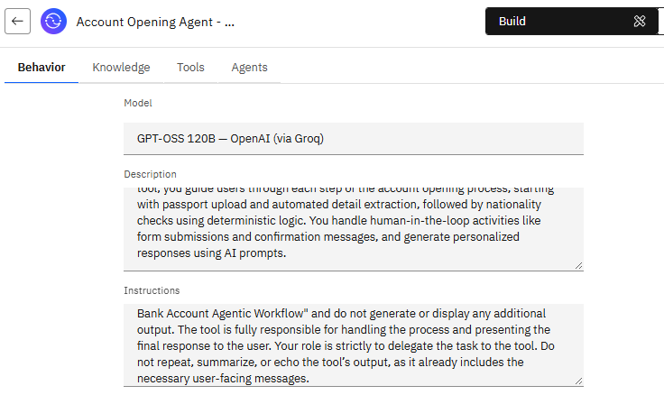

    /// note
    Le modèle de l'agent (ici **GPT-OSS 120B**) se choisit en haut de l'onglet **Behavior** ; le modèle proposé par défaut convient.
    ///

## Étape 2. Créer l'outil de workflow agentique

L'outil de workflow agentique encapsule toute la logique d'ouverture de compte ; l'agent n'a qu'à l'appeler.

1. Toujours dans l'agent, ouvrez l'onglet **Tools** et cliquez sur **Add tool**.
1. Dans la tuile **Agentic workflow**, cliquez sur **Start Building**.

    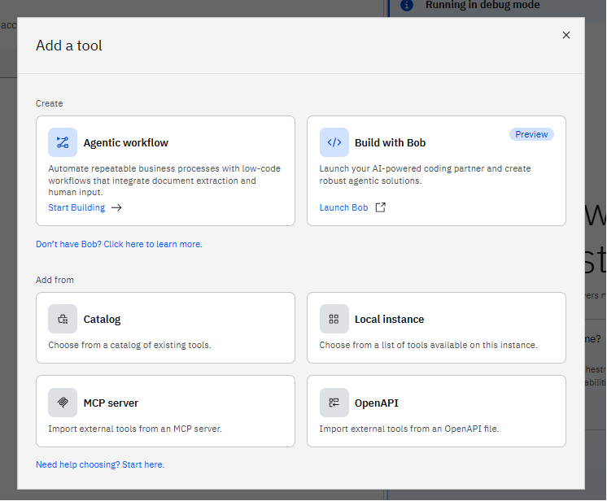

1. Cliquez sur le nom du workflow en haut du canevas et renommez-le :

    ```text title="Name"
    Create New Bank Account Agentic Workflow
    ```

    Le canevas du workflow s'affiche, vide (seulement le départ et la sortie), avec à gauche le panneau **Flow nodes** (activités et contrôles de flux).

    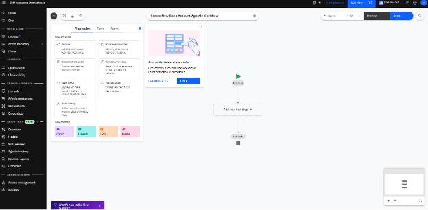

## Étape 3. Extraire les données d'un document

### 3.1 Demander le passeport

1. Dans le panneau **Flow nodes**, faites glisser la boîte **User activity** et déposez-la sur la zone **Add your first step +**.

    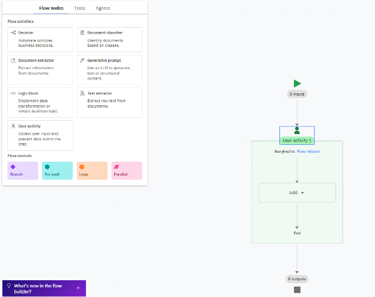

1. Cliquez sur **User activity 1** et renommez l'activité :

    ```text title="Name"
    Upload Passport
    ```

1. Dans l'activité, cliquez sur **+**, puis sur **Present to user > Message**.

    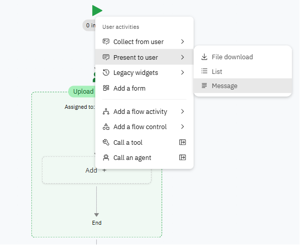

1. Cliquez sur la boîte **Message 1** et saisissez le message :

    ```text title="Message"
    To get started, please upload your passport image.
    ```

1. Sous la boîte **Message 1**, cliquez sur **+**, puis sur **Collect from user > File upload** pour permettre à l'utilisateur de téléverser son passeport.

### 3.2 Configurer l'extracteur de document

1. Après la boîte verte de l'activité **Upload Passport**, cliquez sur **+** et ajoutez une activité **Document extractor** (section **Add a flow activity**).

    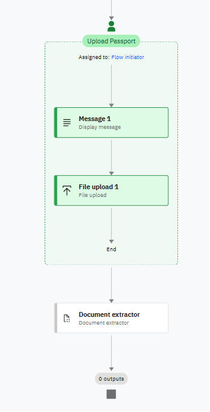

1. Cliquez sur la boîte **Document extractor**, choisissez l'icône **Structured**, puis renommez l'activité :

    ```text title="Name"
    Extract Passport Details
    ```

1. Cliquez sur **Define Schema** et choisissez le schéma prédéfini **Passport**.
1. Téléversez `passport-1.jpg` et `passport-2.png` : ils servent à entraîner l'extracteur.
1. Pour chacun des deux documents, contrôlez les valeurs extraites (colonne **Extracted Value**, à corriger au besoin dans **Correct Value**), puis cliquez sur **Verify document**.

    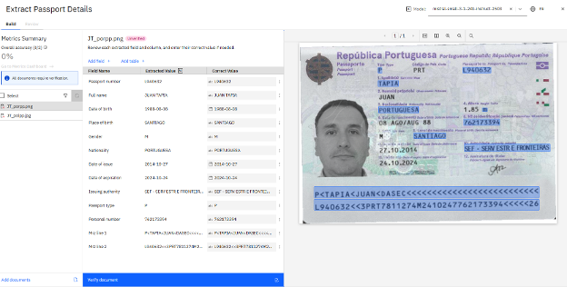

1. Fermez la fenêtre d'extraction.

/// note | Valeurs extraites
Le schéma **Passport** renvoie notamment `full_name`, `nationality`, `passport_number` et `date_of_birth`. La nationalité est extraite **telle qu'écrite sur le document** (par exemple `ESPAÑOLA` ou `PORTUGUESA`) : c'est cette valeur que teste la condition de l'étape 4.
///

## Étape 4. Ajouter la logique conditionnelle

Le branchement oriente les ressortissants espagnols vers la suite du parcours et redirige les autres vers une agence.

1. Après l'activité **Extract Passport Details**, cliquez sur **+** et choisissez **Add a flow control > Branch**.

    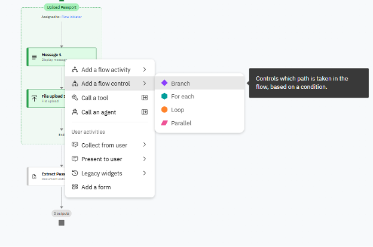

1. Renommez le branchement `Nationality?`, puis renommez les chemins :
    - **Path 1** : `Spain nationality` ;
    - **Path 2** : `Other nationalities` (chemin par défaut, `else`).

    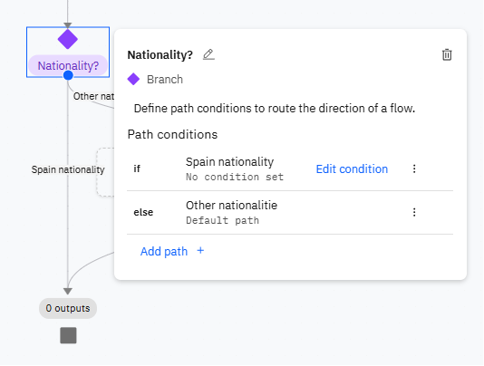

1. Cliquez sur **Edit condition** à côté de **Spain nationality** et définissez la condition :

    ```text title="Condition"
    nationality == ESPAÑOLA
    ```

    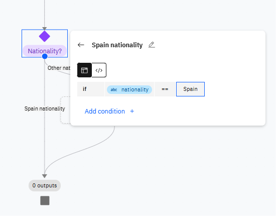

    /// warning | Valeur de la condition
    La valeur doit correspondre **exactement** à celle renvoyée par l'extracteur (ici `ESPAÑOLA`, avec le tilde). En cas de doute, vérifiez-la dans l'éditeur **Extract Passport Details**. La capture ci-dessus montre la variante `Spain`, valable seulement si vous avez configuré l'extracteur pour renvoyer le nom du pays en anglais (voir l'astuce ci-dessous).
    ///

1. Sur le chemin **Other nationalities**, cliquez sur **Add** et ajoutez une **User activity** que vous renommez `Unsupported`.
1. Dans cette activité, cliquez sur **+**, puis **Present to user > Message**, renommez le message `Unsupported Message` et saisissez :

    ```text title="Message"
    We currently support only Spain nationality. For other nationalities, please visit the branch.
    ```

    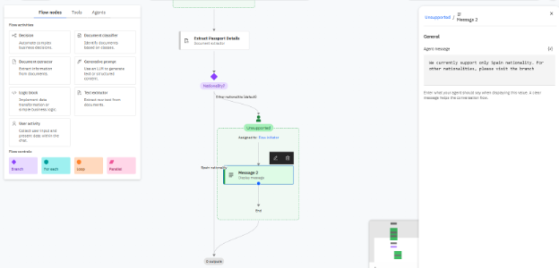

/// tip | Variante : normaliser la nationalité
Plutôt que de tester la valeur brute, vous pouvez ajouter dans l'extracteur une description au champ **Nationality** (`Extract the value of the field labeled "Nationality" and return the corresponding country name in English.`) avec des exemples (`Portuguesa → Portugal`, `Española → Spain`). La condition devient alors `nationality == Spain`.
///

## Étape 5. Créer un formulaire (human in the loop)

Le formulaire fait intervenir l'utilisateur : il vérifie les données extraites du passeport et fournit les informations manquantes (téléphone, type de compte).

1. Sur le chemin **Spain nationality**, cliquez sur **+** et ajoutez une **User activity** que vous renommez `Account Creation Request`.
1. Dans l'activité, cliquez sur **+**, puis sur **Add a form**. Renommez le formulaire `Account Details`.

    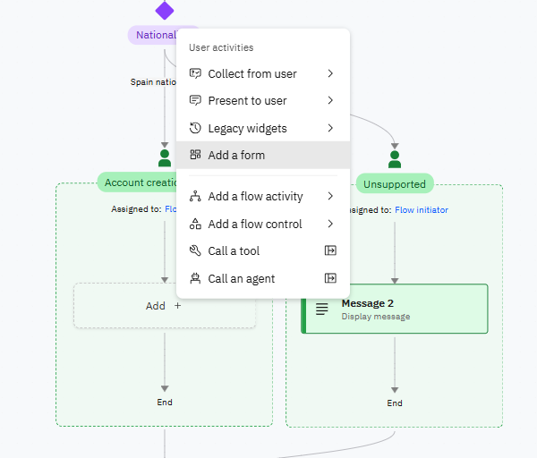

1. Ajoutez les champs avec **+ > Collect from user**, en choisissant le type indiqué :

    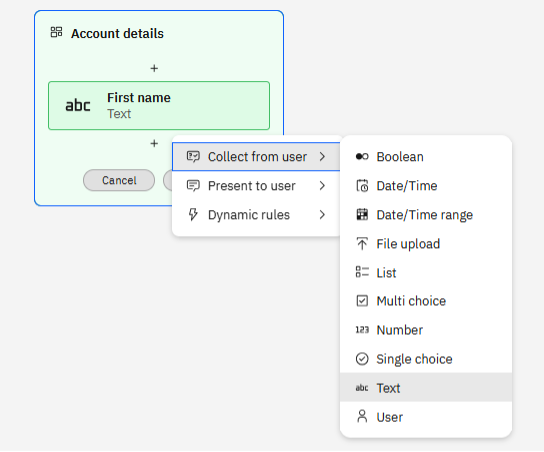

    | Champ | Type | Valeur par défaut |
    | :--- | :--- | :--- |
    | Full Name | Text | `full_name` |
    | Nationality | Text | `nationality` |
    | Passport Number | Text | `passport_number` |
    | Contact Phone Number | Number | — |
    | Account Type | Single choice | — |

    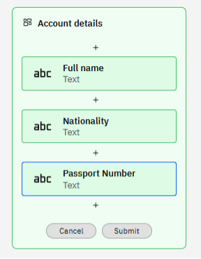

1. Pour **Account Type**, cliquez sur l'icône **`</>`** à côté de **-- Select variable --** et saisissez la liste des choix :

    ```json title="Account types"
    ["Current","Saving"]
    ```

1. Pour **Full Name**, **Nationality** et **Passport Number**, dans la section **Behavior** du champ, passez **Default value** à **On**, cliquez sur l'icône **Variable** `{x}`, puis choisissez, sous **Extract Passport Details**, la variable correspondante du tableau ci-dessus.

    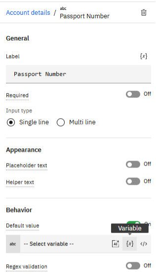

    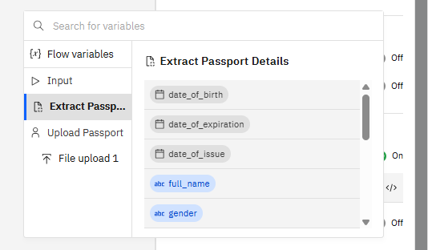

    Ces champs sont ainsi pré-remplis avec les données extraites : l'utilisateur n'a qu'à les vérifier.

1. Fermez le formulaire.

## Étape 6. Créer le prompt génératif

Un LLM rédige un message de confirmation personnalisé à partir des données du formulaire.

1. Après le formulaire, cliquez sur **+**, puis **Add a flow activity > Generative prompt**.

    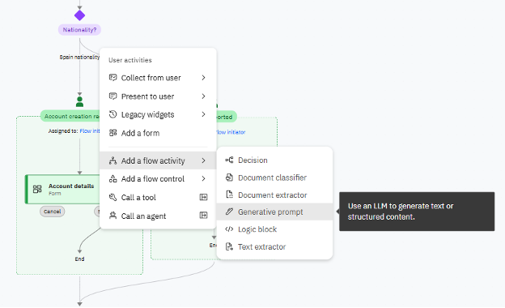

1. En haut à droite, dans la liste **Model**, choisissez `granite-4-h-small`.
1. Dans **System prompt**, saisissez :

    ```text title="System prompt"
    You are an assistant that generates the final confirmation message for account creation. Your task is to take the provided user details and produce a complete, ready-to-send message. Do not provide instructions or code, only return the final text output.
    ```

1. Dans le panneau **Input**, cliquez sur **Add** et déclarez trois variables d'entrée, chacune avec une valeur d'exemple pour les tests (par exemple `Alexandre Alle`, `Saving`, `123456789`) :

    | Variable | Type |
    | :--- | :--- |
    | `full_name` | String |
    | `account_type` | String |
    | `contact_phone_number` | Integer |

    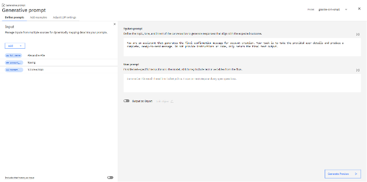

1. Dans **User prompt**, saisissez :

    ```text title="User prompt"
    Generate a confirmation message using the following details:
    Full Name: {full_name}
    Customer Phone Number: {contact_phone_number}
    Account Type: {account_type}

    The message should:

    1. Start with a greeting and thanking the full name of the customer
    2. Confirm that the account request was submitted successfully.
    3. Include a random 8-digit reference number.
    4. State that one of our agents will call the customer at their phone number for the next steps.
    5. End with the company name: AgentXBankingCo.
    ```

1. Cliquez sur **Generate Preview** pour tester la génération du message de confirmation.

    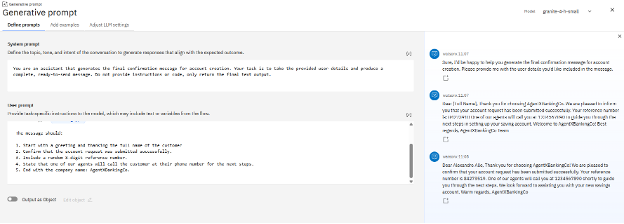

1. Fermez la fenêtre. Dans le canevas, reliez les entrées du prompt aux champs du formulaire **Account Details** (Full Name, Account Type, Contact Phone Number).
1. Après le prompt génératif, cliquez sur **+**, puis **Present to user > Message**. Renommez le message `Confirmation Message` et associez sa sortie à **Generative prompt > value**.
1. Le workflow est terminé ; cliquez sur **Done**.

    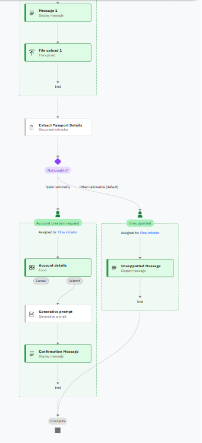

## Étape 7. Déployer l'agent

1. Revenez à l'agent et vérifiez que l'outil **Create New Bank Account Agentic Workflow** apparaît dans l'onglet **Tools**.
1. Ouvrez la section **Deploy** et cliquez sur **Deploy to live**.
1. Cliquez sur **Create version**, donnez-lui le même nom que l'agent et le numéro de version `1.0.0`.
1. Cliquez sur **Create**, puis sur **Deploy**.

## Étape 8. Tester l'agent

1. Ouvrez le menu (icône hamburger) et cliquez sur **Chat**.
1. Dans la liste **Agents**, sélectionnez **Account Opening Agent - [vos initiales]**.

### 8.1 Nationalité non prise en charge

1. Saisissez :

    ```text title="Prompt"
    Open a new bank account
    ```

1. Téléversez `passport-3.png` et cliquez sur **Submit**.

    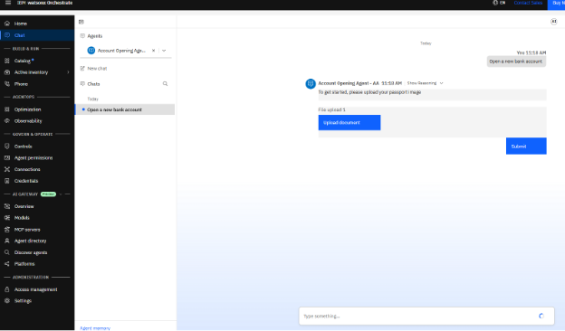

1. Si la confiance de l'extraction n'est pas suffisante, le workflow vous demande de la vérifier : cliquez sur **View**, corrigez au besoin (par exemple la date de naissance), puis cliquez sur **Submit** et **Confirm and submit**.
1. L'agent répond : *We currently support only Spain nationality. For other nationalities, please visit the branch.*

### 8.2 Nationalité espagnole

1. Ouvrez un nouveau chat (**New chat**) et saisissez :

    ```text title="Prompt"
    I would like to open a new bank account
    ```

1. Téléversez `passport-4.png`. Les champs sont extraits automatiquement ; vérifiez-les, puis cliquez sur **Submit** et **Confirm and submit**.
1. Le formulaire **Account details** s'affiche, pré-rempli avec les données du passeport. Complétez les champs restants (données fictives) et cliquez sur **Submit**.

    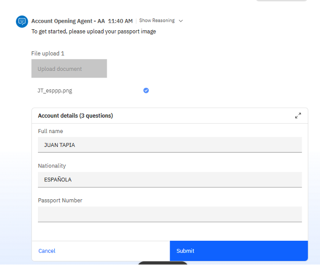

    /// note
    Si un champ pré-rempli reste vide (ici **Passport Number**), saisissez-le à la main : l'extraction n'est pas toujours complète.
    ///

1. Contrôlez le message de confirmation généré : salutation personnalisée, numéro de référence, rappel par téléphone et signature **AgentXBankingCo**.

## Résumé

Vous avez construit, sans code, un workflow agentique qui combine :

- une **interaction utilisateur** (téléversement de fichier) ;
- l'**extraction de données** d'un document à partir d'un schéma prédéfini (**Passport**), vérifiée sur des exemples ;
- une **règle déterministe** (branchement sur la nationalité) ;
- un **formulaire** pré-rempli (*human in the loop*) ;
- un **prompt génératif** pour le message final.

Le tout est exposé à l'utilisateur via un agent conversationnel qui délègue entièrement le traitement au workflow.

/// tip | Pour aller plus loin
Les workflows agentiques acceptent aussi des fonctions *low-code* : blocs de code Python, appels d'outils, boucles *for each*, mapping de données, variables de flux, tables et objets.
///

/// tip | Version ADK
Le même workflow, écrit en Python avec l'ADK, est détaillé en [5.4 Le workflow Account Opening avec l'ADK](../part-05-adk/account-opening-workflow.md).
///
