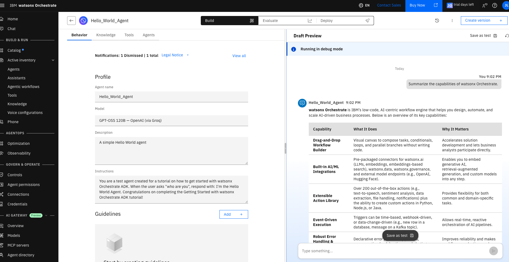

# 5.1 Hello World avec l'ADK

L'**Agent Development Kit (ADK)** de watsonx Orchestrate est une boîte à outils pour développeurs : on décrit ses agents dans des fichiers YAML ou JSON, on crée ses propres outils en Python et on gère tout le cycle de vie des agents avec quelques commandes de la CLI `orchestrate`.

Vous allez installer l'ADK, vous connecter à votre instance SaaS et y importer un premier agent.

## Étape 1. Installer l'ADK

Depuis la racine du dépôt, créez l'environnement Python avec [uv](https://docs.astral.sh/uv/) (l'ADK, `ibm-watsonx-orchestrate`, est déclaré dans `pyproject.toml`), puis vérifiez la CLI :

```shell
uv sync
uv run orchestrate --help
```

## Étape 2. Se connecter à votre instance

Renseignez `WXO_ENV_NAME`, `WXO_URL` et `WXO_API_KEY` dans `.env` (voir [Bien démarrer](../getting-started/README.md)), puis activez l'environnement :

```shell
make bob-orchestrate-activate
```

/// note
Le jeton expire au bout d'un certain temps : relancez cette commande si la CLI répond *token is missing or expired*.
///

## Étape 3. Importer l'agent

L'agent est décrit dans `wxo/hello_world/hello-world-agent.yaml` :

```yaml title="hello-world-agent.yaml"
spec_version: v1
kind: native
name: Hello_World_Agent
description: A simple Hello World agent
instructions: >
  You are a test agent created for a tutorial on how to get started with watsonx Orchestrate ADK.
  When the user asks "who are you", respond with: I'm the Hello World Agent. Congratulations on completing the Getting Started with watsonx Orchestrate ADK tutorial!
llm: groq/openai/gpt-oss-120b
style: react_core
collaborators: []
tools: []
```

```shell
uv run orchestrate agents import -f wxo/hello_world/hello-world-agent.yaml
```

## Étape 4. Tester l'agent

Dans watsonx Orchestrate, ouvrez **Agents > Hello_World_Agent** et posez une question dans le panneau **Preview**, par exemple `who are you`.


