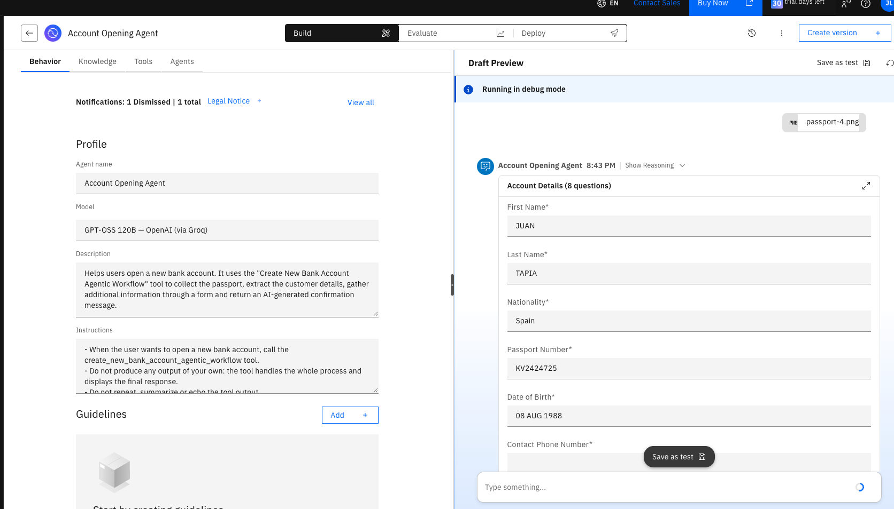
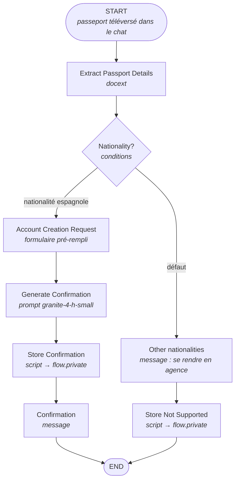

# 5.4 Le workflow Account Opening avec l'ADK

Le workflow **Create New Bank Account** de la [partie 4](../part-04-agentic-workflows/README.md), construit sans code, existe aussi en Python dans `wxo/account_opening_agent/`. Chaque activité du canevas devient un appel au *flow builder* de l'ADK, et le tout s'importe en une commande.



## Le projet

```text
wxo/account_opening_agent/
├── tools/
│   └── create_new_bank_account_flow.py   # le workflow agentique (@flow)
├── agents/
│   └── account_opening_agent.yaml        # l'agent qui appelle le workflow
├── generated/
│   └── create_new_bank_account_flow.json # spécification compilée (pour inspection)
├── debug/                                # extracteur seul, pour diagnostiquer (voir plus bas)
└── import-all.sh
```

| Interface (partie 4) | ADK (`Flow`) |
| :--- | :--- |
| Outil **agentic workflow** | fonction `build_…(aflow: Flow) -> Flow` décorée par `@flow` |
| **Upload Passport** (file upload) | entrée du workflow `input_schema=DocumentProcessingCommonInput` : le chat demande le fichier |
| **Document extractor** + **Add field** | `aflow.docext(fields=...)` avec un `DocExtConfigField` par champ |
| Description et exemples d'un champ | `description` du `DocExtConfigField` (exemples écrits dans le texte) |
| **Branch** | `aflow.conditions()` puis `.condition(expression=..., to_node=...)` |
| **User activity** | `aflow.userflow(...)` |
| **Display to user > Message** | `.activity(...).message_output_field(text=...)` |
| **Form** | `userflow.form(...)` puis `text_input_field`, `number_input_field`, `single_choice_input_field`… |
| Valeur par défaut d'un champ de formulaire | `default=DataMap(...)` vers `self.input.default` |
| **Generative prompt** | `aflow.prompt(llm=..., system_prompt=..., user_prompt=...)` |

## Le workflow



### Points clés du code

- **Téléversement du passeport** : le passeport est l'entrée du workflow (`input_schema=DocumentProcessingCommonInput`). Quand l'agent appelle le workflow, le chat demande le fichier, puis l'extracteur le lit :

    ```python
    extract, _ = aflow.docext(
        name="extract_passport_details",
        display_name="Extract Passport Details",
        fields=PassportFields(),
    )
    extract.map_input(input_variable="document_ref", expression="flow.input.document_ref")
    ```

- **Champs de l'extracteur** : cinq champs texte (numéro de passeport, nationalité, prénom, nom, date de naissance). Les consignes vont dans la `description`, par exemple pour la nationalité :

    ```python
    nationality: DocExtConfigField = Field(
        default=DocExtConfigField(
            name="Nationality",
            field_name="nationality",
            description=(
                "Find the value in the field labeled Nationality and return the corresponding country name in "
                "English, for example Portuguese gives Portugal, Polish gives Poland, Spanish or Española gives Spain."
            ),
        )
    )
    ```

- **Branchement Nationality?** : l'extracteur peut renvoyer la mention du passeport (`ESPAÑOLA`) plutôt que `Spain`. La condition accepte donc plusieurs variantes :

    ```python
    SPANISH_NATIONALITIES = ["spain", "spanish", "españa", "espana", "española", "espanola", "esp"]

    nationality.condition(
        expression=f"str({passport}.nationality).strip().lower() in {SPANISH_NATIONALITIES}",
        to_node=request,
    ).condition(to_node=not_supported, default=True)
    ```

- **Formulaire pré-rempli** : chaque champ issu du passeport reçoit une valeur par défaut, par exemple `flow["extract_passport_details"].output.given_name` pour **First Name**. La date de naissance est un champ texte, car l'extracteur la renvoie au format `08 AUG 1988`.
- **Message final** : le texte d'un message ne peut référencer que `flow.input.*` ou `flow.private.*`. Un nœud *script* copie donc la sortie du prompt dans `flow.private.confirmation_message`, affichée avec `{flow.private.confirmation_message}` et renvoyée comme sortie du workflow. Sur le chemin « autre nationalité », un second script y place le message de refus.
- **Agent** : il appelle le workflow une seule fois et, en cas d'échec, le signale sans relancer l'outil.

## Importer et tester

1. Activez votre environnement (voir [Bien démarrer](../getting-started/README.md)).
1. Téléchargez les passeports de test et importez le workflow, puis l'agent :

    ```shell
    make passport-images
    make wxo-import-account-opening
    ```

    Ce qui équivaut à :

    ```shell
    uv run orchestrate tools import -k flow -f wxo/account_opening_agent/tools/create_new_bank_account_flow.py
    uv run orchestrate agents import -f wxo/account_opening_agent/agents/account_opening_agent.yaml
    ```

1. Dans le chat, sélectionnez **Account Opening Agent**, cliquez sur **Open a new bank account** et téléversez un passeport de `data/passports/` :

    | Passeport | Résultat attendu |
    | :--- | :--- |
    | `passport-4.png` (espagnol) | formulaire pré-rempli (JUAN TAPIA, Spain, KV2424725, 08 AUG 1988), puis message de confirmation |
    | `passport-3.png` (polonais) | message invitant à se rendre en agence |

## Pièges rencontrés

/// warning | Champs de l'extracteur
Sur watsonx Orchestrate SaaS, le nœud `docext` échoue (« An error has occured ») dès qu'un champ utilise `type="date"`, `examples` ou `example_value`. Utilisez des champs texte et écrivez les consignes et exemples dans la `description`.
///

- **Le modèle de l'extracteur** : gardez le modèle par défaut de `docext`. Il lit correctement les images de passeport.
- **Déploiement programmatique** : `compile_deploy()` et `invoke()` ne fonctionnent qu'avec l'édition développeur locale. Sur SaaS, importez avec la CLI et testez dans le chat.
- **Jeton expiré** : si la CLI répond que l'agent est introuvable, réactivez l'environnement (`make bob-orchestrate-activate`).

/// tip | Diagnostiquer un extracteur
Le dossier `debug/` contient un workflow réduit à l'extracteur (`passport_extractor_test_classic`, `passport_extractor_test_layout`) et un agent **Passport Extractor Test**. Tapez `classic` ou `layout`, téléversez une image et lisez les champs extraits : c'est le moyen le plus rapide d'isoler un problème d'extraction.
///

/// note | Pas d'entraînement sur des exemples
Dans l'interface, l'extracteur est affiné avec `passport-1` et `passport-2`. Dans l'ADK, ce rôle revient à la `description` de chaque `DocExtConfigField`.
///

/// tip | Inspecter la spécification
Pour voir le JSON que l'ADK envoie à watsonx Orchestrate, compilez le workflow localement :

```shell
uv run python -c "
import sys; sys.path.insert(0, 'wxo/account_opening_agent/tools')
from create_new_bank_account_flow import build_create_new_bank_account_agentic_workflow as build
build().compile().dump_spec('wxo/account_opening_agent/generated/create_new_bank_account_flow.json')"
```
///
