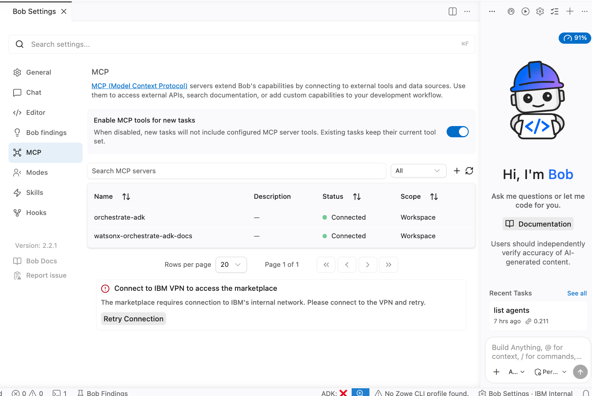

# 5.3 Construire des agents avec Bob

Suivez : [Build agentic workflows with watsonx Orchestrate and IBM Bob](https://developer.ibm.com/tutorials/build-programmatic-agentic-workflows-watsonx-orchestrate-bob/).

## Configurer Bob

Depuis la racine du dépôt, avec votre `.env` renseigné (`WXO_ENV_NAME`, `WXO_URL`, `WXO_API_KEY`, voir [Bien démarrer](../getting-started/README.md)) :

```shell
make bob-developer
```

Cette commande prépare le dossier `.bob/` pour le profil *Developer* et connecte Bob à deux serveurs MCP :

| Serveur MCP | Rôle |
| :--- | :--- |
| `orchestrate-adk` | Agit sur votre instance : lister, importer, exporter des agents et des outils, discuter avec un agent… |
| `watsonx-orchestrate-adk-docs` | Recherche dans la [documentation de l'ADK](https://developer.watson-orchestrate.ibm.com/) |

Elle installe aussi :

- la compétence `wxo-development` (`.bob/skills/`) ;
- les règles `wxo-development.md` (`.bob/rules/`) et `wxo-implementation-guide.md` (racine du dépôt) ;
- le mode Bob *developer* (`.bob/custom_modes.yaml`) ;
- et active l'environnement watsonx Orchestrate `WXO_ENV_NAME`.

Le fichier `.bob/mcp.json` est généré à partir de `bob-mcp/mcp.developer.json`, en remplaçant les variables `${…}` par les valeurs du `.env`.

## Vérifier la connexion des serveurs MCP

Dans Bob, ouvrez **Bob Settings > MCP** : `orchestrate-adk` et `watsonx-orchestrate-adk-docs` doivent être à l'état **Connected**.



Bob peut alors chercher la bonne syntaxe dans la documentation de l'ADK et agir directement sur votre instance (importer, tester, exporter) : vous construisez vos agents plus vite, sans quitter l'éditeur. Pour le vérifier, demandez-lui par exemple :

```text title="Prompt de test"
list agents
```

## Vérifier et réinitialiser la configuration

```shell
make bob-status   # profil actif, compétences et règles installées
make bob-reset    # supprime la configuration Bob (.bob/mcp.json est sauvegardé)
```
