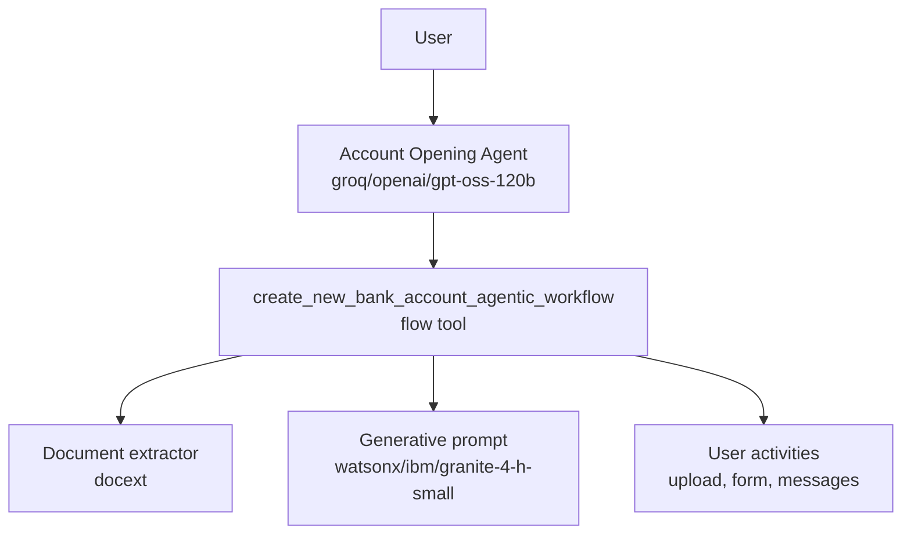
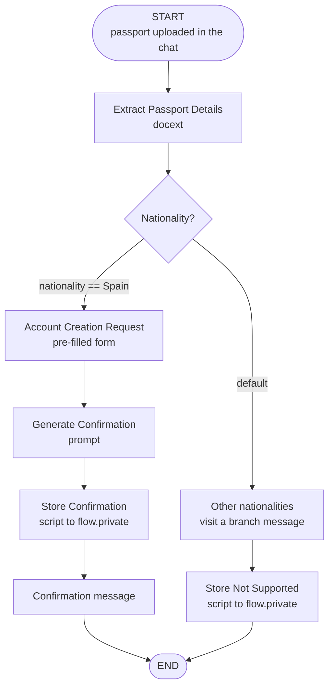

# Account Opening Agent (ADK)

## Overview

ADK version of the no-code tutorial
[Creating intelligent, reusable agentic workflows on watsonx Orchestrate with no code](https://developer.ibm.com/learningpaths/get-started-watsonx-orchestrate/create-agentic-workflows-no-code/).

The **Account Opening Agent** delegates every account-opening request to the
**Create New Bank Account Agentic Workflow** flow tool, which uploads a passport, extracts its details,
checks the nationality, collects the remaining data through a pre-filled form, and returns a confirmation
message generated by Granite 4.0 H Small.

## Architecture Diagram



## Workflow Diagram



## Usage

### Via Chat UI

```shell
./import-all.sh
```

In the watsonx Orchestrate chat, select **Account Opening Agent** and click **Open a new bank account**.

### Compile the flow spec

```shell
uv run python -c "
import sys; sys.path.insert(0, 'wxo/account_opening_agent/tools')
from create_new_bank_account_flow import build_create_new_bank_account_agentic_workflow as build
build().compile().dump_spec('wxo/account_opening_agent/generated/create_new_bank_account_flow.json')"
```

## Inputs and outputs

- **Input**: the passport (`DocumentProcessingCommonInput.document_ref`), uploaded by the user in the chat.
- **Extracted fields**: passport number, nationality (English country name), given name, surname, date of birth.
- **Form fields**: first name, last name, nationality, passport number, date of birth (pre-filled),
  contact phone number, annual income, account type (Current / Saving).
- **Output**: `confirmation_message`.

## Prerequisites

- A watsonx Orchestrate instance (SaaS) with document extraction and `watsonx/ibm/granite-4-h-small` available.
- Synthetic passport images from the SynID dataset (arXiv 2505.07540) to test:
  a non-Spanish passport (rejected) and a Spanish one (form + confirmation).
