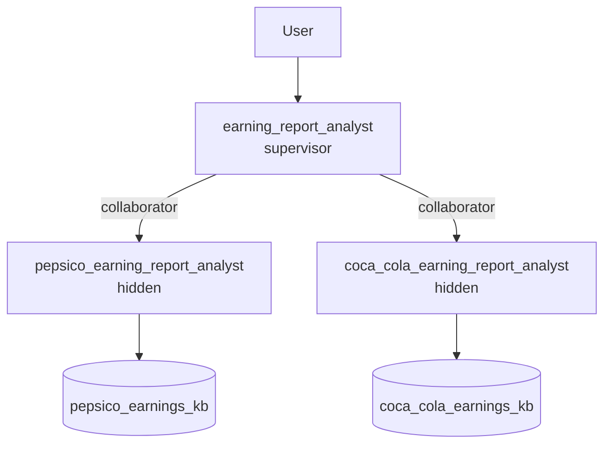
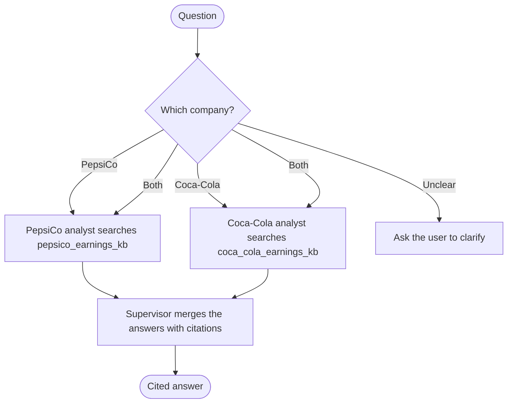

# Earning Report Analyst (ADK)

ADK version of the no-code tutorial in [part 3](../../docs/part-03-no-code-agents/README.md): a supervisor
agent routes earnings questions to two specialist agents, each with its own knowledge base.

## Architecture



## Workflow



## Usage

The knowledge bases upload the local documents in `data/earnings/`, downloaded with `make earnings-docs`.

```shell
make earnings-docs          # once: download the 8 documents into data/earnings/
make wxo-import-earnings    # import knowledge bases, then specialists, then the supervisor
uv run orchestrate knowledge-bases status -n pepsico_earnings_kb
```

When both knowledge bases are ready, open **Chat** and select **Earning Report Analyst**.

The agents use [gpt-oss-120b](https://www.ibm.com/docs/en/watsonx/saas?topic=models-third-party-foundation#gpt-oss)
(`groq/openai/gpt-oss-120b`). See `uv run orchestrate models list` to change `llm:`.
